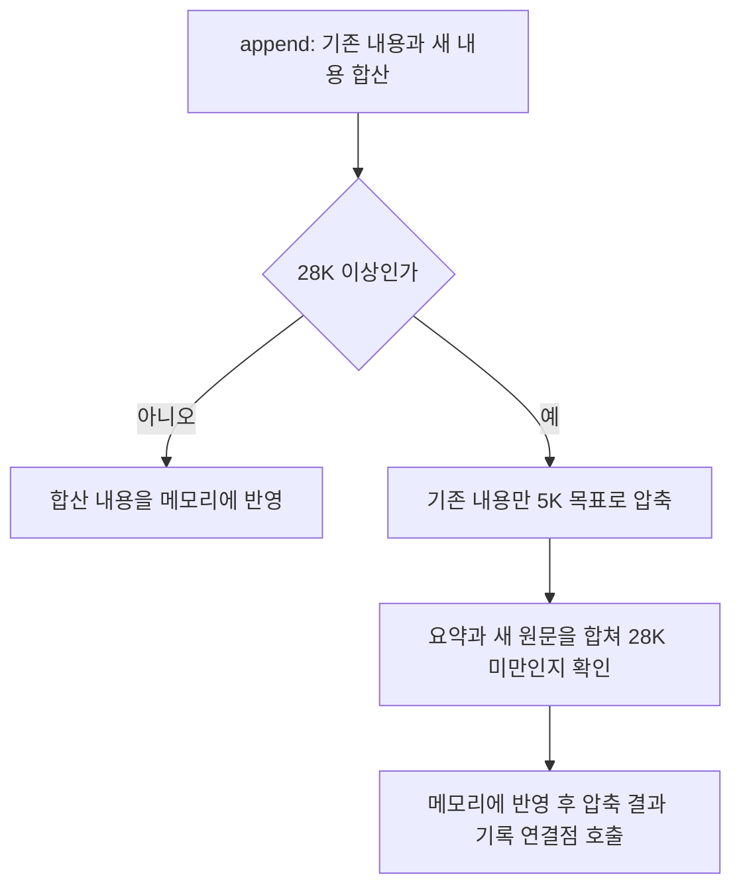

# ContextManager 사용과 처리 흐름

**대상:** [context_manager.py](../server/app/runtime/context_manager.py)의 `ContextManager`. 설계 5.4에 대응하며 로컬 모델의 대화 이력을 보관하고 압축한다. 코드 기준은 `7b0b2f8`이다.

**인스턴스:** 컨텍스트를 사용하는 run_id마다 1개를 생성해 재사용한다. 프로그램 전체에는 여러 개가 존재할 수 있고, 모두 [Runner 1개](local-llm-runner.md)의 모델을 공유한다. 각 관리자 안에서 다시 `(chat_id, prompt_idx)`별 이력을 분리한다.

## 처리 흐름



- 압축 요청의 생성 상한은 7,000토큰이다. 5,000토큰은 목표이며 초과한 정상 요약도 사용한다.
- 압축 요청은 stop이 와도 완료까지 처리한다. 일반 호출 로그를 끄고 반영된 요약만 별도로 기록한다.
- 새 내용만으로 임계값에 도달하거나 압축 뒤 합산 내용도 임계값 이상이면 예외다. 실제 생성 실패·빈 요약도 예외이며 기존 내용을 보존한다.

## 사용법과 입출력

```python
manager = runner.get_context_manager("run-1")
context_id = manager.get_id("chat-1", "ANSWER")
manager.append(context_id, "\nUser: 질문\nAssistant: 답변\n")
count = manager.get_context_length(context_id)
manager.compact_context(context_id)
summary = manager.get_context(context_id)
```

`request(..., use_context=True)`는 정상 대화를 자동 누적한다. 위 append는 직접 이력을 관리할 때 사용하며, 같은 대화를 수동으로 다시 추가하지 않는다.

| 호출 | 반환과 사용 기준 |
| --- | --- |
| `get_id(chat_id, prompt_idx)` | 같은 조합의 ID를 재사용하고 없으면 생성한다. 반환은 int다. |
| `new_id()` | 채팅·작업에 매핑하지 않은 독립 ID를 만든다. |
| `get_context(context_id)` | 현재 문자열을 반환한다. |
| `get_context_length(context_id)` | 동일 모델의 실제 토크나이저로 계산한 토큰 수를 반환한다. |
| `append(context_id, text)` | 새 내용을 붙이고 필요하면 기존 내용을 자동 압축한다. 반환은 None이다. |
| `compact_context(context_id)` | 명시적으로 압축한다. 빈 이력은 생략하며 반환은 None이다. 결과는 get_context로 읽는다. |

- 설정을 바꾸려고 `ContextManager(runner, run_id, ...)`를 직접 만들면 같은 실행을 요청하기 전에 `runner.context_managers[run_id]`에 등록한다. 기본 사용은 get_context_manager로 조회한다.
- context_id는 해당 관리자 안에서만 유효하다. 서로 다른 실행의 ID가 같은 정수여도 이력은 별개다.
- 저장은 인스턴스 메모리 방식이다. 다른 run_id에는 이전 실행의 이력을 자동으로 이어 붙이지 않는다.

## 설계서 대비 추가 및 변경

- **실행별 인스턴스:** Runner의 `get_context_manager(run_id)`로 관리자 여러 개를 보관한다. 내부 저장소는 ID를 키로 사용하는 dict이며 메모리 접근에 RLock을 사용한다.
- **압축 시점:** 원설계 37쪽의 기존 길이 검사 대신 새 내용을 합친 길이로 28K 경계를 검사한다. 사용자 확정 사항이다. 내부 압축 생성은 공통 `_compact_text()`가 수행한다.
- **목표와 상한 분리:** 원설계의 5K 목표에 생성 상한 7K를 별도로 둔다. 5K 초과를 성공 실패 조건으로 쓰지 않는다.
- **압축 중지 정책:** 진행 중인 압축은 완료·반영한다. 자동 압축 중 stop이면 바깥 request가 이후 stopped를 반환하며 이미 완성된 대화도 남는다.
- **반환 해석:** compactContext의 함수 표는 void, 상세 절차는 생성 결과 리턴으로 적혀 있다. 현재는 표의 void를 따라 None을 반환하고 get_context로 결과를 읽는다.
- **DB 기록:** 최신 [스키마](db-schema.md)와 사용자 결정에 따라 전용 컨텍스트 테이블 저장·복원은 사용하지 않는다. 압축 반영 후 `messages.role="context_compacted"`, `content=요약`으로 한 번 저장할 예상 호출을 주석으로 둔다. 시각은 ChatManager의 createdAt이며 압축 원문은 저장하지 않는다. 독립 new_id의 기록은 먼저 채팅 귀속을 정해야 한다.
