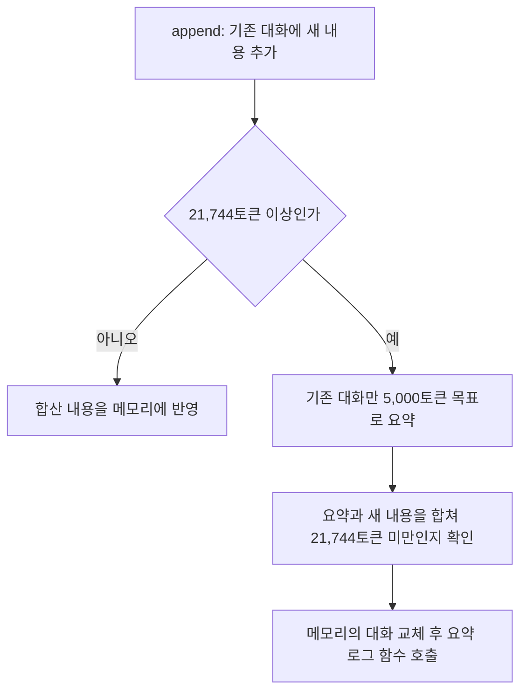

# ContextManager 사용과 처리 흐름

**대상:** [context_manager.py](../server/app/runtime/context_manager.py)의 `ContextManager`. 설계 5.4의 이전 대화 저장, 토큰 수 계산 및 대화 압축 처리. 대화 압축은 기존 대화를 모델로 요약해 저장 내용을 줄이는 기능.

**객체 수:** 이전 대화를 사용하는 실행 ID(run_id)마다 1개를 생성해 재사용. 프로그램 전체에서 여러 객체를 사용할 수 있으며 모두 [LocalLLMRunner 1개](local-llm-runner.md)의 모델을 공유. 각 객체 안에서 채팅 ID(chat_id)와 작업 종류(prompt_idx)에 따라 대화 내용 분리.

| 토큰 길이 한도 | 값 |
| --- | --- |
| 전체 컨텍스트(입력 + 출력) | 32,768토큰 |
| 일반 답변 / 압축 답변의 출력 상한 | 각각 5,000토큰 |
| 압축 목표 | 5,000토큰 |
| 자동 압축 기준(기존 대화 + 새 내용) | 21,744토큰 |

## 처리 흐름



- 요약 목표와 최대 응답은 모두 5,000토큰
- 자동 압축 기준은 **21,744토큰**. `32,768 - 일반 답변 5,000 - 요약 답변 5,000 - 여유분 1,024`로 계산하고 새 내용을 포함한 길이로 판단
- 압축은 일반 답변 수신을 마친 뒤 대화를 저장할 때, 또는 다음 요청의 입력 예산을 확인할 때 처리. 답변 수신 도중 압축은 생략
- 일반 요청 전에 새 입력·시스템 프롬프트·최대 출력까지 더한 길이가 넘치면 Runner에서 먼저 압축 요청
- 요약 요청에도 이 객체의 run_id 전달. `runner.stop(run_id)`로 중지 신호를 받아도 요약 완료까지 수신
- 일반 요청 로그를 생략하고 저장된 요약으로 별도 로그 함수 호출. 실제 데이터베이스 저장 코드는 미구현
- length 종료는 같은 입력으로 최초 포함 최대 3회 요청. 모두 잘리면 False 반환, 기존 대화 유지 및 요약 로그 생략. 요청 오류·나머지 생성 실패·빈 요약은 예외 전달
- 새 내용만으로 입력 한도에 도달하거나 요약 후 합산 내용도 한도 이상인 경우 예외 발생. 기존 대화 유지

## 사용법과 입출력

```python
manager = runner.get_context_manager("run-1")
context_id = manager.get_id("chat-1", "ANSWER")
manager.append(context_id, "\nUser: 질문\nAssistant: 답변\n")
count = manager.get_context_length(context_id)
success = manager.compact_context(context_id)
summary = manager.get_context(context_id)
```

`request(..., use_context=True)`는 형식 검사를 통과한 답변과 해당 입력을 자동으로 저장. 위 append는 직접 대화 내용을 관리할 때 사용. request로 저장한 대화를 append로 다시 추가하면 중복 저장되므로 한 가지 방식 선택.

| 호출 | 반환과 사용 기준 |
| --- | --- |
| `get_id(chat_id, prompt_idx)` | 채팅·작업에 해당하는 대화 번호 조회 또는 생성. 반환값은 int |
| `new_id()` | 채팅·작업에 연결하지 않은 새 대화 번호 발급 |
| `get_context(context_id)` | 해당 대화 번호에 저장된 문자열 반환 |
| `get_context_length(context_id)` | 저장된 대화를 응답 생성 모델 기준으로 토큰화해 토큰 수 반환 |
| `append(context_id, text)` | 새 내용 추가 후 토큰 한도에 따라 기존 대화 요약. 성공 시 True, length로 3회 실패 시 False |
| `compact_context(context_id)` | 저장된 대화를 바로 요약. 성공 또는 빈 대화는 True, length로 3회 실패 시 False. 결과는 get_context로 조회 |

- `ContextManager(runner, run_id, ...)`로 객체를 직접 만들 경우 request 호출 전에 `runner.context_managers[run_id]`에 등록. 기본 설정으로 사용할 때는 get_context_manager로 조회
- context_id는 해당 객체 안에서 사용하는 대화 번호. 서로 다른 실행의 대화 번호가 같아도 저장 내용은 별개
- 대화 내용은 객체의 메모리에 저장. 다른 run_id로 요청하면 기존 실행의 대화는 자동으로 사용하지 않음

## 설계서 대비 추가 및 변경

- **객체 관리:** Runner의 `get_context_manager(run_id)`에서 실행별 객체 조회 또는 생성. 대화 번호와 문자열은 dict에 저장. 같은 스레드에서 다시 획득할 수 있는 RLock으로 메모리 접근 보호
- **자동 요약 시점:** 설계 37쪽의 기존 대화 길이만 검사하는 방식에서 새 내용과 요약 출력 예산도 포함하는 방식으로 변경. 실제 요약 요청은 `_compact_text()`에서 처리
- **요약 길이:** 목표와 최대 응답은 모두 5,000토큰. length로 잘린 요약은 저장하지 않고 최대 3회 요청
- **중지 처리:** `runner.stop(manager.run_id)`로 해당 실행에 중지 요청. 요약이 정상 완료되면 메모리에 반영하고 이미 완성된 입력·답변 유지. 자동 요약은 이후 request에서 stopped 반환하며, 직접 호출한 compact_context는 처리 결과를 bool로 반환
- **반환값:** 설계서의 반환값 없음에서 성공 여부를 bool로 반환하도록 변경. length 재시도 실패 시 False로 구분하고 요약 결과는 get_context로 조회
- **데이터베이스 기록:** 최신 [테이블 구조](db-schema.md)에 따라 별도 컨텍스트 테이블은 사용하지 않음. 요약 반영 후 `messages.role="context_compacted"`, `content=요약`으로 한 번 저장할 코드를 주석 처리. 저장 시각은 ChatManager에서 createdAt에 기록할 예정. 요약 전 원문은 저장하지 않으며, new_id로 직접 발급한 대화 번호는 먼저 채팅과 연결 필요
