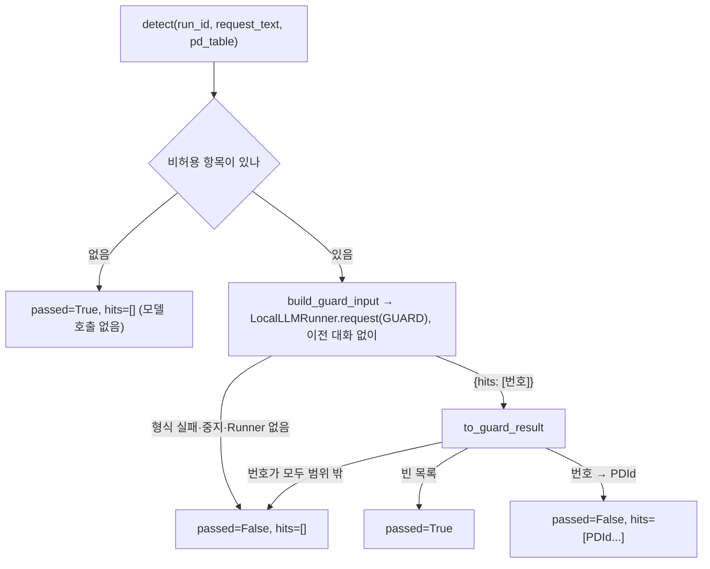

# LeakGuard 사용과 처리 흐름

**대상:** [leak_guard.py](../server/app/pipeline/leak_guard.py)의 `LeakGuard`. 설계 3.3의 요청문 누출 검사.

**객체 수:** 프로그램당 1개. 생성자에 공유 `LocalLLMRunner`를 넘김. 상태를 저장하지 않음.

**역할:** RequestWriter가 쓴 요청문에 허용되지 않은 개인정보가 드러났는지 로컬 모델이 판단. `passed=True`인 요청문만 Main이 FrontierClient로 보냄.

## 함수

| 함수 | 입력 | 반환 | 내용 |
| --- | --- | --- | --- |
| `detect()` | `run_id`, `request_text`, `pd_table`, `chat_id=None` | `GuardResult` | 비허용 항목을 골라 모델로 검사 |
| `build_guard_input()` | `request_text`, `target_items` | `str` | 금지 항목에 0부터 번호·종류를 붙인 목록 + 요청문 |
| `to_guard_result()` | `hit_idx`, `target_items` | `GuardResult` | 모델이 돌려준 번호를 PDId로 변환 |

`GuardResult`(`passed: bool`, `hits: list[int]`)는 Main과 함께 쓰므로 [llm_results.py](../server/app/models/llm_results.py)에 둠.

## 처리 흐름



모델 입력 예:

```text
[금지 목록]
0.[속성정보] 25살
1.[식별정보] 김민수

[요청문]
...
```

- 검사 대상은 `allowed=False`인 항목. 이 순서가 모델에 보이는 번호
- `GUARD` 출력 형식(`{"hits": [번호]}`)은 LocalResParser가 검사하고, 형식 오류 재시도(최대 3회)는 Runner가 처리
- 번호는 중복 제거, 범위 밖 번호는 무시
- **설계 보완:** 모델이 번호를 돌려줬지만 모두 범위 밖이거나 걸린 항목에 `pd_id`가 없으면 통과시키지 않고 `passed=False, hits=[]`. 설계서대로면 이 경우 hits가 비어 통과되는데, 모델이 "걸렸다"고 답한 요청문을 내보내지 않기 위해서임
- 잘못된 호출(빈 요청문, 표 형식 오류)은 예외

## Main 연결

Main의 `_write_safe_request()`가 이미 이 결과대로 동작함(이번 변경 없음).

| 결과 | Main 동작 |
| --- | --- |
| `passed=True` | 프론티어로 전송 |
| `passed=False`, hits 있음 | `RequestWriter.rewrite()`로 고친 뒤 다시 검사 |
| `passed=False`, hits 없음 | 무엇을 고칠지 모르므로 재작성 없이 `regen_limit` 종료 (전송 안 함) |

- 동작 로그(`log_event(run_id, "guard", ...)`)는 ChatManager 구현 후 연결. 지금은 주석으로 위치만 표시

## 사용법

```python
from app.pipeline.leak_guard import LeakGuard

guard = LeakGuard(runner)
result = guard.detect(run_id, request_text, pd_table)
if result.passed:
    ...  # 전송
else:
    ...  # result.hits로 재작성 (비어 있으면 실패 처리)
```
