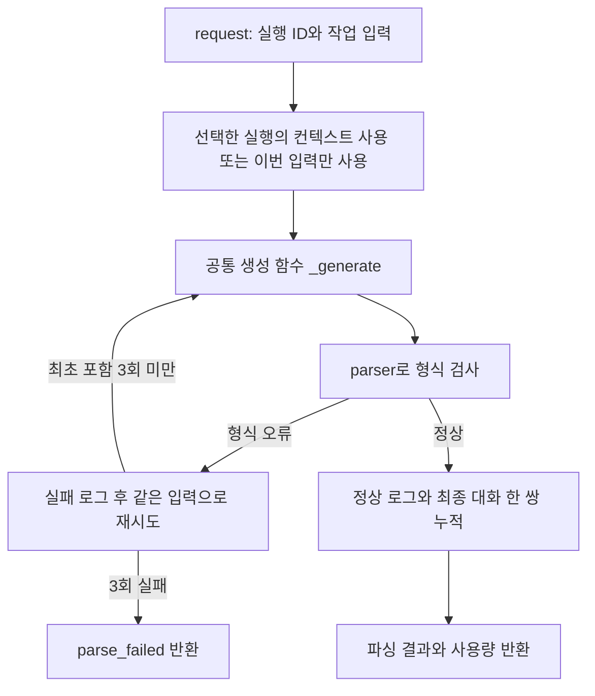

# LocalLLMRunner 사용과 처리 흐름

**대상:** [local_llm_runner.py](../server/app/runtime/local_llm_runner.py)의 `LocalLLMRunner`. 설계 5.1에 대응하며 모델 생성·결과 파싱·재시도·중지를 묶는다. 코드 기준은 `7b0b2f8`이다.

**인스턴스:** 프로그램당 Runner 1개를 생성해 공유한다. `run_id`는 `request()`마다 전달하며, 컨텍스트는 [실행별 ContextManager](context-manager.md)로 분리한다. 생성자에서 짧은 응답으로 모델을 검사하고, 프로그램 종료 시 `close()`로 정리한다.

## 처리 흐름



- `use_context=False`이면 컨텍스트 조회·누적을 생략한다.
- 각 생성 시도를 한 번씩 로그 연결점에 전달한다. 실제 저장 호출은 아직 주석이다.
- 일반 생성 중 중지하면 부분 원문을 반환한다. 호출 오류는 로그 연결점을 거쳐 그대로 전파한다.
- `manual_request()`와 단독 `regen()`도 `_generate()`를 사용하며 파싱·대화 누적을 하지 않는다.

## 사용법과 입출력

```python
from app.runtime.local_llm_runner import LocalLLMRunner

runner = LocalLLMRunner()  # 프로그램 시작 시 한 번 생성
result = runner.request(
    "run-1", "처리할 글", "ANSWER", "chat-1",
    use_context=True,
    system_prompt="한국어로 답하세요.",
    prompt_version="v1",
    on_token=lambda chunk: print(chunk, end="", flush=True),
)
# 프로그램 종료 시 runner.close()
```

| 호출 | 사용 방법 |
| --- | --- |
| `request(run_id, input_, prompt_idx, chat_id, ...)` | 작업별 [파싱 결과](local-res-parser.md)를 받는다. 컨텍스트 사용은 기본 False이며, True일 때 chat_id가 필요하다. |
| `manual_request(input_, system_prompt, ...)` | 직접 지정한 프롬프트로 원문을 받는다. 선택적으로 run_id를 전달한다. |
| `regen(input_, system_prompt, ...)` | 같은 입력을 다시 생성한다. 컨텍스트를 읽으려면 use_context=True와 run_id·context_id를 전달한다. |
| `get_context_manager(run_id)` | 해당 실행의 관리자를 조회하거나 처음 사용할 때 생성한다. |
| `stop()` | 다른 스레드에서도 중지 신호를 보낼 수 있다. |
| `close()` | 진행 중인 모델 작업의 정리를 기다린 뒤 자원을 닫는다. `with`도 지원한다. |

반환은 **`(결과, 성공 여부, 입력 토큰, 출력 토큰, 종료 사유)`**다.

- 작업 성공: 첫 값은 파싱 결과다. 수동 호출·단독 재생성은 문자열이다.
- 형식 실패 3회: `(None, False, 누적 입력 토큰, 누적 출력 토큰, "parse_failed")`다.
- 중지: 부분 원문과 False, `"stopped"`를 반환한다. 재생성 본문이 아직 없으면 직전 출력을 보존한다.
- 사용량은 작업의 모든 생성 시도를 합산한다. 한 번이라도 모르는 항목의 합계는 None이다.
- 일반 생성 상한은 기본 2,048토큰이며 `max_tokens`로 지정한다. `on_token`은 본문 청크마다 호출하는 선택 콜백이다.
- 정상 종료한 빈·공백 출력도 형식 재시도에 포함한다. 종료 사유 없는 무응답·불완전 스트림과 래퍼 오류는 예외로 전파한다.
- 압축 중 stop은 [압축 완료·반영 뒤](context-manager.md) 적용한다. 이 경우 이미 완성된 대화는 컨텍스트에 남는다.

## 설계서 대비 추가 및 변경

- **반환 확장:** 원설계 5.1의 성공 여부·결과에 사용량·종료 사유를 추가하고 결과를 첫 값으로 둔다. 사용자 확정 사항이다.
- **생성 함수 분리:** 수동 호출·작업 호출·단독 재생성이 `_generate()`를 공유한다. request 내부에서 다른 공개 생성 함수를 호출하지 않는다.
- **동일 입력 재생성:** 원설계 30쪽의 이전 출력·오류·교정 지시 추가를 제거했다. 최초 포함 형식 실패 3회로 제한하고, 최종 정상 대화만 한 번 누적한다.
- **호출별 컨텍스트:** 고정 CONTEXT_TASKS 대신 use_context를 받는다. Runner는 하나를 공유하고 실행별 관리자를 갖는다. `run_id`를 요청마다 받는 것은 원설계와 같다.
- **스트리밍과 중지:** bool 플래그 대신 Event와 수신 스레드로 중지를 처리하고 청크 콜백을 추가했다. 원격 서버 추론 자체의 즉시 취소는 보장하지 않는다.
- **어댑터와 실행 설정:** 기존 로컬 LLM 래퍼를 사용한다. 키 탐색은 래퍼에 맡기며, 네이티브 전환은 Llama import를 바꾸는 방식이다. 설계 31쪽의 세부 GPU 옵션은 현재 생성자에서 모두 지정하지 않는다.
- **초기 응답 검사와 시간 제한:** 생성자 응답 검사·연결 정리와 기본 120초의 호출 제한을 추가했다. 호출 오류를 대체 응답으로 바꾸지 않는다.
- **프롬프트와 로그 연결:** PromptManager의 `(본문, 버전)` 반환을 가정한다. 현재는 인자로 받고 조회 호출은 주석이다. 일반 로그에는 실행·작업·버전·소요 시간·검사 결과와 새 입력·원시 출력만 전달하며 ChatManager 저장 호출도 주석이다.
