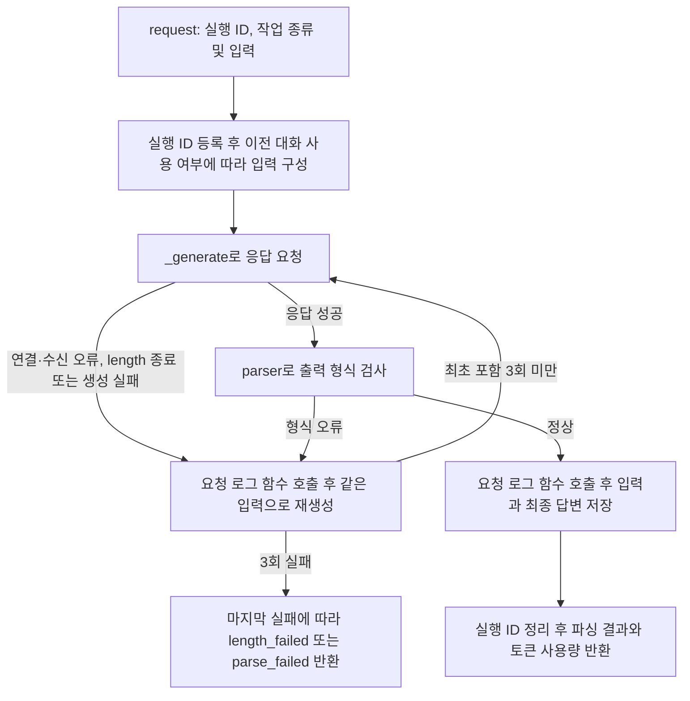

# LocalLLMRunner 사용과 처리 흐름

**대상:** [local_llm_runner.py](../server/app/runtime/local_llm_runner.py)의 `LocalLLMRunner`. 설계 5.1의 모델 준비, 응답 요청, 결과 파싱, 재생성 및 중지 처리.

**객체 수:** 프로그램당 LocalLLMRunner 1개를 생성해 공유. `run_id`는 작업 실행 ID로 요청마다 전달. 이전 대화 내용(컨텍스트)은 [실행 ID별 ContextManager](context-manager.md)에서 관리. 생성자에서 짧은 응답으로 연결 확인 후 사용하고, 프로그램 종료 시 `close()` 호출.

| 토큰 길이 한도 | 값 |
| --- | --- |
| 전체 컨텍스트(입력 + 출력) | 32,768토큰 |
| 연결 확인·일반 요청·수동 요청·재생성의 출력 상한 | 각각 5,000토큰 |
| 컨텍스트 압축 목표 / 출력 상한 | 5,000토큰 / 5,000토큰 |
| 자동 압축 기준 | 21,744토큰 |
| 채팅 형식 등 여유분 | 1,024토큰 |

## 처리 흐름



- `use_context=False`이면 이전 대화 조회와 저장 생략
- 요청마다 `_log_call()` 호출. 실제 데이터베이스 저장 코드는 미구현으로 주석 처리
- 일반 응답 생성 중 중지하면 중지 전까지 받은 답변 반환. 모델 요청 오류도 로그 함수 호출 후 재시도하고, 최대 횟수 도달 시 실패값 반환
- `manual_request()`와 `regen()`은 `_generate()`로 응답을 요청하고 결과 파싱과 이전 대화 저장은 생략
- Runner는 파싱·재생성·대화 저장을 포함해 한 번에 요청 하나 처리. 진행 중 새 요청은 RuntimeError로 전달
- 재시도 대상은 출력 형식 오류, 연결·수신 오류, 타임아웃, 무응답, 응답 도중 연결 종료, length 종료 및 생성 실패. 같은 입력으로 최초 요청 포함 최대 3회 시도하며 중지는 제외
- 타임아웃 후에는 이전 수신이 정리된 뒤 다음 요청 진행. 정리 대기 중에도 stop(run_id)로 중지 가능

## 사용법과 입출력

저장소 루트에서 실행. `app`과 래퍼의 `src`를 모두 찾을 수 있도록 Python 경로 지정. 별도 패키지 추가는 불필요.

```powershell
$repo_root = (Get-Location).Path
$env:PYTHONPATH = "$repo_root;$repo_root\server"
uv run --project server python
```

위 Python 실행 환경에서 다음 코드 사용.

```python
from app.runtime.local_llm_runner import LocalLLMRunner

runner = LocalLLMRunner()  # 프로그램 시작 시 한 번 생성
run_id = "run-1"

# 취소 버튼 등 다른 스레드에서 호출할 함수
def cancel_request() -> None:
    runner.stop(run_id)

result = runner.request(
    run_id, "처리할 글", "ANSWER", "chat-1",
    use_context=True,
    system_prompt="한국어로 답하세요.",
    prompt_version="v1",
    on_token=lambda chunk: print(chunk, end="", flush=True),
)
# 프로그램 종료 시 runner.close()
```

| 호출 | 사용 방법 |
| --- | --- |
| `request(run_id, input_, prompt_idx, chat_id, ...)` | 작업별 응답을 요청하고 [파싱 결과](local-res-parser.md) 반환. 이전 대화 사용 여부는 기본 False. True일 때 chat_id 필요 |
| `manual_request(input_, system_prompt, run_id=..., ...)` | 직접 지정한 프롬프트로 응답 요청 후 답변 문자열 반환. 중지하려면 stop에 전달할 ID와 같은 run_id 지정 |
| `regen(input_, system_prompt, run_id=..., ...)` | 같은 입력으로 답변 재생성. 이전 대화 사용 시 use_context=True와 context_id 필요. 중지하려면 같은 run_id 지정 |
| `get_context_manager(run_id)` | 해당 실행의 ContextManager 조회 또는 생성 |
| `stop(run_id)` | 실행 ID가 일치하는 요청에 중지 신호 전달 후 즉시 None 반환. 다른 ID 또는 진행 중인 요청이 없는 경우 생략 |
| `close()` | 진행 중인 수신이 끝날 때까지 기다린 뒤 모델 자원 해제. `with` 사용 시 자동 호출 |

- 중지는 요청이 진행 중일 때 다른 스레드에서 호출. 요청 종료 후 실행 ID와 중지 신호 정리
- 진행 중인 요청이 없을 때 보낸 중지 신호는 이후 요청에 적용하지 않음

**반환 순서:** `(결과, 성공 여부, 입력 토큰 수, 출력 토큰 수, 종료 사유)`

- 작업 성공: 첫 값은 파싱 결과. `manual_request()`와 `regen()`의 첫 값은 답변 문자열
- 최대 3회 시도 후 모두 실패한 경우: `(None, False, 총 입력 토큰 수, 총 출력 토큰 수, 종료 사유)` 반환. 마지막 실패가 출력 상한 도달이면 `"length_failed"`, 나머지는 `"parse_failed"`
- 입력·답변이 너무 길어 이전 대화에 저장할 수 없는 경우에도 `"length_failed"` 실패 튜플 반환. 결과는 None이며 기존 대화 유지. 저장 실패에 따른 재생성은 생략
- `manual_request()`와 `regen()`도 length 종료만 최대 3회 재시도. 모두 실패하면 첫 값은 빈 문자열, 성공 여부는 False, 종료 사유는 `"length_failed"`. 나머지 요청 오류는 예외 전달
- `context_full`: 시스템 프롬프트·입력·채팅 형식 여유분·최대 출력의 합계가 32,768토큰을 초과. 모델 요청 없이 실패값 반환
- 중지: 중지 전까지 받은 답변, False, `"stopped"` 반환. 재생성 답변을 아직 받지 못했다면 직전 답변 유지
- 토큰 수: 재생성을 포함한 총 사용량. 사용량을 받지 못한 요청이 있으면 해당 합계는 None
- `max_tokens`: 응답의 최대 토큰 수. 연결 확인·일반 요청·재생성·요약 모두 상한 5,000. 요청별로 더 낮은 값은 지정 가능하며 5,000 초과는 ValueError
- 자동 압축 기준은 21,744토큰. 일반 답변 5,000토큰과 요약 5,000토큰의 공간을 각각 확보
- 요청 입력 예산: `32,768 - max_tokens - 1,024 - 시스템 프롬프트 토큰 수`. 채팅 형식 여유분 1,024토큰 확보. `get_input_limit(system_prompt)`로 조회
- 이전 대화가 포함된 요청이 입력 예산을 넘으면 기존 대화를 먼저 압축한 뒤 요청. 압축도 length로 3회 실패하면 `length_failed` 반환
- `on_token`: 답변 일부를 받을 때 실행할 함수. 한 번에 전달되는 문자열에 여러 토큰이 포함될 수 있음
- 빈 답변이나 공백만 있는 답변도 재시도 횟수에 포함. 입력 설정, 화면 출력 함수 및 파서 내부 코드의 오류는 재시도 없이 예외 전달
- 대화 압축 중 중지 신호를 받으면 [요약 저장을 마친 뒤](context-manager.md) 중지 처리. 이 경우 이미 완성된 대화도 유지

## 설계서 대비 추가 및 변경

- **반환값:** 설계 5.1의 성공 여부·결과에 토큰 사용량·종료 사유 추가. 결과를 튜플의 첫 값으로 반환
- **최종 실패:** 설계 5.1의 `(false, 없음)`에 맞춰 결과는 None, 성공 여부는 False. 마지막 실패가 length 종료이면 length_failed, 나머지는 parse_failed. 입력 예산 초과는 context_full로 구분
- **응답 생성:** `manual_request()`, `request()`, `regen()`에서 `_generate()`를 공유. request 안에서 다른 공개 요청 함수를 호출하는 방식은 사용하지 않음
- **재생성:** 설계 30쪽의 이전 출력·오류·수정 지시 추가 없이 같은 입력으로 요청. 파싱 오류뿐 아니라 모델 요청·수신 실패도 재시도하고 종류를 합쳐 최초 요청 포함 최대 3회 시도. 최종 성공한 입력·답변만 한 번 저장. manual_request와 regen은 length 종료만 최대 3회 요청
- **이전 대화 사용:** 작업 종류에 따라 고정하지 않고 요청마다 use_context로 선택. Runner는 프로그램당 1개, ContextManager는 실행 ID마다 1개. run_id는 설계대로 요청마다 전달
- **중지:** `stop(run_id)`로 실행 ID가 일치하는 요청만 중지. 생성·파싱·재생성·대화 저장까지 같은 중지 신호를 공유하고 요청 종료 시 실행 ID 정리. Event와 별도 수신 스레드로 중지 처리. 원격 서버에서 진행 중인 생성 작업 취소는 별도 기능
- **모델 실행:** 기존 로컬 모델 래퍼를 사용하고 인증키 검색도 래퍼에서 처리. llama-cpp-python 직접 사용 시 Llama import 변경. 설계 31쪽의 세부 그래픽카드 설정 중 일부만 현재 생성자에 지정
- **연결 확인:** 생성자에서 실제 응답 확인 후 사용. 응답 대기 시간은 요청 한 번당 기본 120초. request의 최종 실패는 반환값으로 전달. 생성자 확인과 manual_request는 오류 발생 시 즉시 예외 전달
- **프롬프트와 로그:** PromptManager의 반환값은 `(본문, 버전)`으로 예정. 현재는 인자로 전달하고 조회 코드는 주석 처리. 로그 항목은 실행 ID·작업 종류·버전·소요 시간·검사 결과·새 입력·생성된 답변. ChatManager의 저장 코드도 미구현으로 주석 처리
