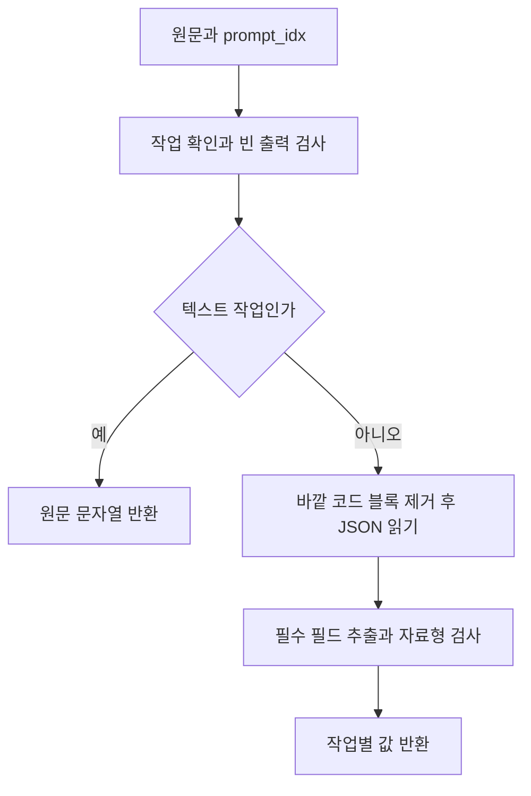

# 결과 파서 사용과 처리 흐름

**대상:** [local_res_parser.py](../server/app/runtime/local_res_parser.py)의 `parser()`와 `OutputFormatError`. 공유 작업 종류는 [enums.py](../server/app/models/enums.py), 결과 자료형은 [llm_results.py](../server/app/models/llm_results.py)에 정의. 설계 5.2의 모델 출력 형식 검사 및 작업별 결과 반환.

**객체 수:** parser를 사용하기 위한 객체 생성은 불필요. 함수 호출 사이에 결과를 저장하지 않고 매번 전달받은 출력만 검사. OUTPUT_FORMAT의 자료형 검사 객체는 모듈을 불러올 때 한 번 생성.

## 처리 흐름



출력 형식 오류는 `OutputFormatError`로 전달. [LocalLLMRunner](local-llm-runner.md)에서 이 예외를 받아 같은 입력으로 재생성. 연결 오류·타임아웃의 재시도도 Runner에서 처리. 파서 안에서 재생성이나 로그 저장은 생략.

## 사용법과 입출력

```python
from app.runtime.local_res_parser import OutputFormatError, parser

try:
    hits = parser('{"hits":[0,2]}', "GUARD")  # [0, 2]
except OutputFormatError:
    ...  # Runner에서 같은 입력으로 재생성
```

| 작업 종류(prompt_idx) | 모델 출력 형식 | 반환 자료형 |
| --- | --- | --- |
| DETECT | `{"items":[{"text":"…","category":0}]}` | `list[DetectedItem]` |
| NEEDS | `{"needs":["…"]}` | `list[str]` |
| JUDGE | `{"enough":true,"needConsent":false,"consentItems":[],"need":[]}` | `Plan` |
| GUARD | `{"hits":[0,2]}` | `list[int]` |
| PARSE_RULES | `{"rules":[{"target":"…","scope":"item","action":"deny"}]}` 또는 아래 해석 불가 응답 | `list[Rule]` 또는 `RuleParseFailure` |
| MATCH_RULES | `{"matches":[{"item":0,"rules":[1]}]}` | `list[RuleMatch]` |
| CONSENT | `{"purpose":"…","benefit":"…","risk":"…"}` | `ConsentText` |
| DECIDE_CONTEXT | `{"context":"keep"}` 또는 reset | `"keep"` 또는 `"reset"` |
| WRITE / REWRITE / ANSWER / MEMO_SUMMARY | 비어 있지 않은 텍스트 | `str` |

- `PromptIdx`는 `app.models.enums`, 결과 자료형은 `app.models.llm_results`에서 import. 기존 파서 경로의 import도 유지. 작업 종류는 위 표의 12개와 외부 모델용 FRONTIER
- 반환 객체의 필드는 위 모델 출력 형식과 동일. `Plan`의 needConsent·consentItems는 파이썬에서 `need_consent`·`consent_items`로 접근. consent_items는 데이터베이스의 개인정보 ID 목록
- DetectedItem.category는 0 식별·1 민감·2 속성 중 하나. GUARD와 MATCH_RULES의 정수는 입력 목록에서 0부터 시작하는 항목 번호
- 항목 번호를 데이터베이스 ID로 바꾸거나 입력 목록 범위 안의 번호인지 확인하는 역할은 호출자에서 처리
- 형식에 맞는 빈 목록도 성공으로 반환. 텍스트의 줄바꿈·들여쓰기 유지
- PARSE_RULES의 명시적 해석 불가는 `{"ok":false,"rules":[],"message":"수정 안내"}`다. 필수 필드와 빈 규칙 목록, 공백이 아닌 안내를 검증하고 `RuleParseFailure`를 반환한다. Runner는 재생성 없이 `interpretation_failed`로 전달한다. 기존 성공 형식은 유지하며 `ok:true`도 허용한다. 빈 성공 목록과 해석 불가를 구분한다.
- MATCH_RULES의 `rules` 목록은 모델이 의미와 우선순위를 판단한 **최종 규칙 하나의 인덱스** 또는 빈 목록이다. 개인정보 항목마다 정확히 하나의 대응이 필요하다. 입력 범위·중복·누락·복수 선택 검사는 PrivacySettings가 담당한다.
- JSON 전체를 감싼 코드 블록 표시만 제거. 설명문 속 JSON 추출, 잘못된 문법 수정 및 자동 자료형 변환은 생략
- 알 수 없는 작업이나 외부 모델용 FRONTIER를 전달한 경우 `ValueError` 발생. 답변을 다시 생성할 오류와 구분

## 설계서 대비 추가 및 변경

- **함수 구성:** 설계 32~33쪽의 check→parser를 parser 하나로 통합. 모델 출력을 직접 받아 JSON 읽기와 자료형 검사를 한 번씩 수행
- **오류 처리:** 형식 검사를 통과한 값만 반환하고 오류는 OutputFormatError로 전달. 설계 check의 `(통과 여부, 결과, error)` 반환은 사용하지 않음. 재시도 횟수와 최종 실패 처리는 Runner에서 관리
- **자료형 정의:** 작업 종류는 문자열 StrEnum, 반환 객체는 Pydantic 모델로 정의. 공유 자료형은 코드 컨벤션에 따라 `app/models/`에서 관리. 파서는 TypeAdapter로 필드·자료형·허용값 검사. 정의되지 않은 추가 필드는 기본적으로 무시
- **JSON 읽기:** 문법 오류 외에 파이썬의 정수 자릿수·중첩 한도를 넘긴 경우도 출력 형식 오류로 처리. 코드 블록 안의 유니코드 문자열 유지
