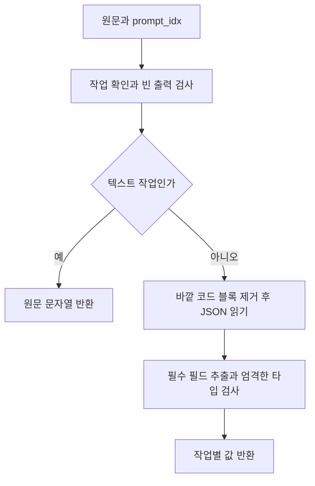

# 결과 파서 사용과 처리 흐름

**대상:** [local_res_parser.py](../server/app/runtime/local_res_parser.py)의 `parser()`, `OutputFormatError`, 작업 이름과 결과 타입. 설계 5.2에 대응하며 모델 출력의 형식을 검사하고 작업별 값으로 변환한다.

**인스턴스:** 생성하지 않는다. 상태 없는 함수이며 여러 호출이 공유한다. OUTPUT_FORMAT의 검증기들은 모듈을 가져올 때 한 번 준비한다.

## 처리 흐름



형식 오류는 `OutputFormatError`로 올린다. [Runner](local-llm-runner.md)가 이 예외만 잡아 재시도하며, 파서는 재시도나 로그 저장을 하지 않는다.

## 사용법과 입출력

```python
from app.runtime.local_res_parser import OutputFormatError, parser

try:
    hits = parser('{"hits":[0,2]}', "GUARD")  # [0, 2]
except OutputFormatError:
    ...  # Runner에서는 같은 입력으로 재생성한다.
```

| prompt_idx | 기대 출력 | 반환 |
| --- | --- | --- |
| DETECT | `{"items":[{"text":"…","category":0}]}` | `list[DetectedItem]` |
| NEEDS | `{"needs":["…"]}` | `list[str]` |
| JUDGE | `{"enough":true,"needConsent":false,"consentItems":[],"need":[]}` | `Plan` |
| GUARD | `{"hits":[0,2]}` | `list[int]` |
| PARSE_RULES | `{"rules":[{"target":"…","scope":"item","action":"deny"}]}` | `list[Rule]` |
| MATCH_RULES | `{"matches":[{"item":0,"rules":[1]}]}` | `list[RuleMatch]` |
| CONSENT | `{"purpose":"…","benefit":"…","risk":"…"}` | `ConsentText` |
| DECIDE_CONTEXT | `{"context":"keep"}` 또는 reset | `"keep"` 또는 `"reset"` |
| WRITE / REWRITE / ANSWER / MEMO_SUMMARY | 비어 있지 않은 텍스트 | `str` |

- `PromptIdx`와 결과 타입은 이 파이썬 파일에 함께 정의하며 필요한 호출자는 여기서 가져온다. 작업 이름은 위 표의 12개와 외부 모델용 FRONTIER다.
- 반환 객체의 필드는 위 기대 출력과 같다. `Plan`의 needConsent·consentItems는 Python에서 `need_consent`·`consent_items`로 읽으며 consent_items는 실제 PDId 목록이다. DetectedItem.category는 0 식별·1 민감·2 속성만 받는다.
- 정상 빈 목록은 성공이다. 텍스트의 줄바꿈·들여쓰기는 보존한다.
- JSON 전체를 감싼 여러 줄 코드 블록만 제거한다. 설명문 속 JSON 추출·문법 복구·자동 타입 보정은 하지 않는다.
- GUARD와 MATCH_RULES의 정수는 입력 목록의 번호다. 실제 PDId 변환과 번호의 상한 검사는 호출 모듈이 담당한다.
- 알 수 없는 작업과 로컬 파싱 대상이 아닌 FRONTIER는 `ValueError`다. 형식 재시도 대상으로 취급하지 않는다.

## 설계서 대비 추가 및 변경

- **단일 함수:** 원설계 32~33쪽의 check→parser 구조를 parser 하나로 합쳤다. JSON 원문을 직접 받고 검사·변환을 한 번 수행한다. 사용자 확정 사항이다.
- **오류 전달:** 정상 값만 반환하고 형식 실패는 OutputFormatError로 올린다. 원설계 check의 `(통과 여부, 결과, error)` 반환은 사용하지 않는다. 최종 실패 반환은 Runner가 담당한다.
- **타입 정의:** 작업 목록은 문자열 StrEnum이며 반환 객체는 Pydantic 모델이다. 별도 공유 파일 없이 파서 파일 안에 두고 TypeAdapter로 필드·자료형·허용값을 검사한다. 추가 필드는 기본적으로 무시한다.
- **디코더 제한:** JSON 문법뿐 아니라 정수 자릿수·중첩 제한 오류도 형식 오류로 분류한다. 코드 블록 안의 유니코드 문자열은 그대로 보존한다.
