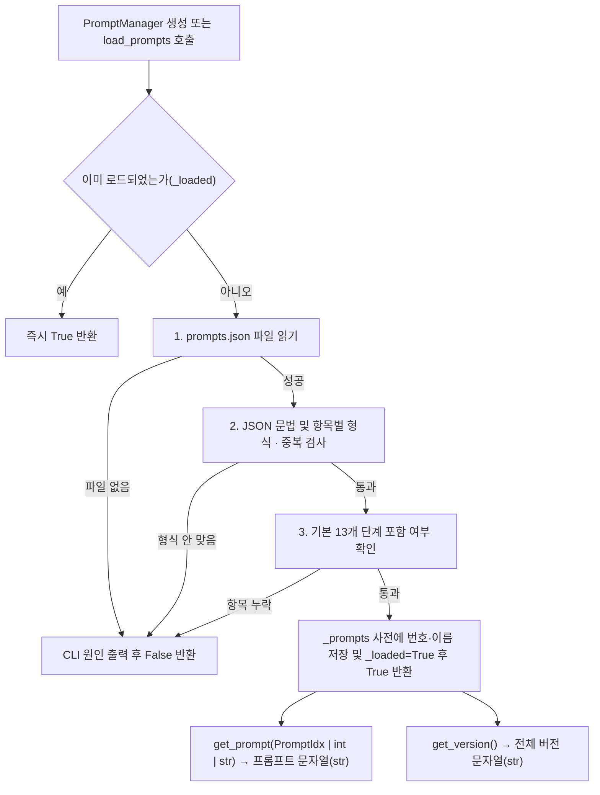

# PromptManager 사용과 처리 흐름

**대상:** [prompt_manager.py](../server/app/data/prompt_manager.py)의 `PromptManager`와 [prompts.json](../server/app/prompts/prompts.json). 설계 6.1의 단계별 시스템 프롬프트 및 프롬프트 버전 조회.

**객체 수:** 프로그램당 PromptManager 1개를 생성해 공유. 생성자에서 기본 JSON 파일을 최초 1회 읽어 메모리에 보관하며, 한 번 로드된 뒤에는 `load_prompts()`를 다시 호출해도 파일 재읽기 없이 즉시 `True`를 반환.

## 파일 형식 (`server/app/prompts/prompts.json`)

- 데이터베이스 테이블 대신 `app/prompts/prompts.json` 파일에서 시스템 프롬프트를 관리
- 버전(`version`)은 개별 프롬프트마다 두지 않고 파일 맨 앞에 전체 버전 하나만 기록
- 각 프롬프트 항목은 `idx`(0 이상의 정수), `name`(단계 이름), `prompt`(시스템 프롬프트) 세 필드로 구성
- 기본 13개 단계(`0: DETECT` ~ `12: MEMO_SUMMARY`)의 번호와 이름이 표와 일치해야 하며, 추후 새로운 단계(`idx >= 13`)가 생기면 JSON의 `prompts` 목록에 `idx`, `name`, `prompt`를 추가한 뒤 `PromptManager`를 다시 생성하면 코드 수정 없이 숫자 `idx`나 `name` 문자열로 조회 가능. 기존 인스턴스는 JSON 변경을 자동으로 다시 읽지 않으며, 로드에 성공한 인스턴스는 `load_prompts()`를 다시 호출해도 파일을 다시 읽지 않음
- `prompt` 값은 일반 문자열(`str`)과 줄 단위 문자열 배열(`list[str]`)을 모두 허용하며, 배열로 작성한 경우 로드 시 `\n`으로 결합해 하나의 문자열로 보관

```json
{
  "version": "0.0",
  "prompts": [
    {
      "idx": 0,
      "name": "DETECT",
      "prompt": "여기에 시스템 프롬프트 입력"
    },
    "... (기본 0 ~ 12번 항목 포함) ...",
    {
      "idx": 13,
      "name": "NEW_STAGE",
      "prompt": [
        "첫 번째 줄 지시문",
        "두 번째 줄 지시문"
      ]
    }
  ]
}
```

### 기본 등록 단계 (`0` ~ `12`)

| `idx` | `name` (`PromptIdx`) | 사용 위치 |
| :---: | --- | --- |
| `0` | `DETECT` | `PDDetector.detect()` |
| `1` | `NEEDS` | `Planner.list_needs()` |
| `2` | `JUDGE` | `Planner.judge()` |
| `3` | `WRITE` | `RequestWriter.write()` |
| `4` | `REWRITE` | `RequestWriter.rewrite()` |
| `5` | `GUARD` | `LeakGuard.detect()` |
| `6` | `ANSWER` | `AnswerGenerator.generate()` |
| `7` | `PARSE_RULES` | `PrivacySettings.parse_rules()` |
| `8` | `MATCH_RULES` | `PrivacySettings.apply_to_table()` |
| `9` | `CONSENT` | `ConsentManager.build_message()` |
| `10` | `DECIDE_CONTEXT` | `FrontierClient.decide_context()` |
| `11` | `FRONTIER` | `FrontierClient.send()` |
| `12` | `MEMO_SUMMARY` | `MemoManager.compact_answer()` |

## 처리 흐름



## 사용법과 입출력

```python
from app.data.prompt_manager import PromptManager
from app.models.enums import PromptIdx

pm = PromptManager()  # 생성 시 기본 prompts.json 최초 1회 로드

# 1. 열거형(PromptIdx), 숫자(idx), 문자열 이름(str) 모두 동일한 프롬프트 문자열 반환
p1 = pm.get_prompt(PromptIdx.DETECT)
p2 = pm.get_prompt(0)
p3 = pm.get_prompt("DETECT")

# 2. 파일 전체 버전 조회 (로그 기록용)
version = pm.get_version()  # "0.0"

# 3. Main.init() 등에서 호출 시 이미 로드되어 있으면 바로 True 반환
ok = pm.load_prompts()
```

| 호출 | 반환과 사용 기준 |
| --- | --- |
| `PromptManager(prompt_file=DEFAULT_PROMPT_FILE)` | 기본 경로(`app/prompts/prompts.json`) 또는 지정 경로로 객체 초기화 및 최초 1회 로드 시도 |
| `load_prompts()` | 아직 로드되지 않았을 때만 JSON 파일을 읽어 검증 후 멤버 변수에 저장. 이미 로드되었거나 로드에 성공하면 `True`, 실패(① 파일 없음 ② 형식 안 맞음 ③ 기본 13개 항목 누락) 시 CLI에 원인을 출력하고 `False` 반환 |
| `get_prompt(prompt_idx)` | `PromptIdx`(`StrEnum`), 정수 `idx`, 단계 이름 `str`을 받아 시스템 프롬프트 문자열(`str`) 반환. 미로드 시 `RuntimeError`, 미등록 키는 `KeyError`, 잘못된 자료형(`bool` 포함)은 `TypeError` |
| `get_version()` | JSON 최상단의 전체 버전 문자열(`str`) 반환. 미로드 시 `RuntimeError` |

## 설계서 대비 추가 및 변경

- **파일 구조와 버전 관리:** 설계 6.1의 폴더 내 개별 파일·항목별 버전 대신 `app/prompts/prompts.json` 단일 파일에서 최상단 `version` 1개로 통합 관리. 긴 프롬프트 작성을 위해 `prompt` 필드에 문자열 배열(`list[str]`) 허용
- **단일 사전을 통한 다중 키 조회:** 하나의 사전(`_prompts`)에 정수 `idx`(`0`~`12`)와 문자열 `name`(`PromptIdx` 포함)을 함께 매핑하며, 기본 13개 단계 외에 새 항목(`idx`, `name`, `prompt`)을 JSON에 추가한 뒤 인스턴스를 다시 생성하면 코드 변경 없이 조회 가능
- **반환값 분리:** 설계 6.1의 `getPrompt() -> (내용, 버전)` 튜플 대신 `get_prompt() -> str`과 `get_version() -> str`로 분리. `LocalLLMRunner.request()`에서 생성자로 받은 PromptManager의 두 메서드를 각각 호출
- **1회 로드 플래그(`_loaded`) 및 실패 원인 출력:** 최초 로드 성공 후 재호출 시 즉시 `True`를 반환해 별도 잠금(Lock) 없이 `Main.init()` 호출과 호환하며, 실패 시 3가지 원인(파일 없음 · 형식 안 맞음 · 기본 13개 항목 누락)을 CLI에 안내
