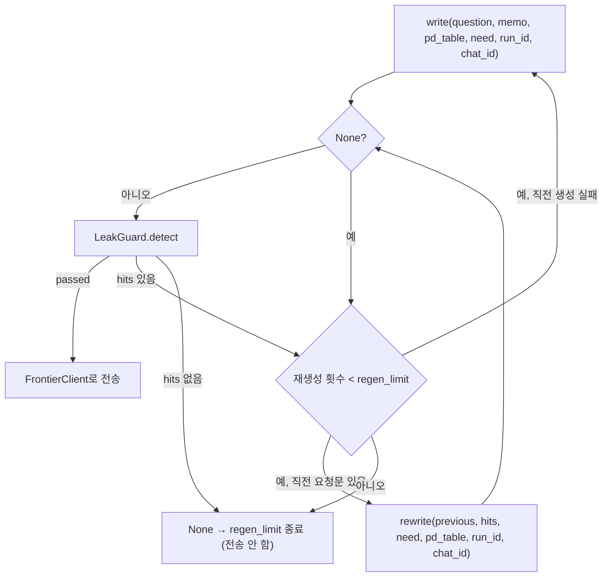

# RequestWriter 사용과 처리 흐름

**대상:** [request_writer.py](../server/app/pipeline/request_writer.py)의 `RequestWriter`. 설계 3.2의 도움 요청문 생성(`write`)과 재작성(`rewrite`).

**객체 수:** 프로그램당 1개. 생성자에 공유 `LocalLLMRunner`를 넘김. 상태를 저장하지 않으므로 여러 실행이 같은 객체를 써도 됨.

**역할 경계:** 요청문을 쓰고 고치기만 함. 전송 허가는 하지 않으며, 모든 요청문(재작성 결과 포함)은 Main에서 LeakGuard 검사를 통과해야 FrontierClient로 감.

## 함수

| 함수 | 입력 | 반환 | 내용 |
| --- | --- | --- | --- |
| `write()` | `question`, `memo`, `pd_table`, `need`, `run_id=""`, `chat_id=None` | `str \| None` | need의 미해결 항목을 묻는 요청문. 허용 개인정보는 유지, 비허용은 빼거나 일반화 |
| `rewrite()` | `previous_request`, `hits`, `need`, `pd_table`, `run_id=""`, `chat_id=None` | `str \| None` | LeakGuard가 잡은 항목(`hits`의 pd_id)의 표현만 수정. need 내용과 허용 정보는 유지 |

- 로컬 모델은 `LocalLLMRunner.request(run_id, 입력, PromptIdx.WRITE | REWRITE, chat_id)`로 호출. 같은 입력의 재시도(최대 3회)는 Runner가 처리
- `run_id`를 넘겨야 중지 버튼(`Main.stop` → `LocalLLMRunner.stop(run_id)`)이 생성을 끊을 수 있음
- **생성 실패는 `None`**: 모델 실패, 중지, 빈 답변, Runner 없음. `rewrite()`는 `hits`가 표의 어떤 항목과도 맞지 않으면 모델을 부르지 않고 `None`
- **잘못된 호출은 예외**: 빈 질문·빈 직전 요청문·빈 need는 `ValueError`, 자료형 오류는 `TypeError`, 개인정보 표 형식 오류는 `RuntimeError`
- 모델이 붙인 코드 블록, `요청문:` 같은 머리말, 전체를 감싼 따옴표는 떼어 냄
- `pd_table`은 `PDItem` 목록이나 같은 필드를 가진 dict 목록 모두 가능

## 모델 입력

`write()`

```text
[질문]           원문 질문
[필요 정보]      - need 항목
[메모]           지금까지 모은 답 (없으면 "없음")
[허용된 개인정보] - 원문 (종류)
[금지된 개인정보] - 원문 (종류)
```

`rewrite()`

```text
[직전 요청문]     검사에 걸린 요청문
[고칠 개인정보]   - hits에 해당하는 항목 원문 (종류)
[필요 정보]       - need 항목
[허용된 개인정보] - 원문 (종류)
```

종류 이름은 `CATEGORY_LABEL`(식별정보·민감정보·속성정보). 시스템 프롬프트는 `prompts.json`의 `WRITE`(3), `REWRITE`(4)이며 요청문 본문만 출력하게 함.

## Main 연결



- 반복은 Main의 `_write_safe_request()`가 담당. 생성 실패(`None`)도 검사에 걸린 것과 같이 재생성 횟수에 포함
- 재작성 결과도 매번 LeakGuard를 거치며, 통과하지 못한 요청문은 전송하지 않음
- 동작 로그(`log_event(run_id, "draft", ...)`)는 ChatManager 구현 후 연결. 지금은 주석으로 위치만 표시

## 사용법

```python
from app.pipeline.request_writer import RequestWriter

writer = RequestWriter(runner)
text = writer.write(question, memo, pd_table, need, run_id, chat_id)
if text is not None:
    result = leak_guard.detect(run_id, text, pd_table)
    if not result.passed:
        text = writer.rewrite(text, result.hits, need, pd_table, run_id, chat_id)
```
