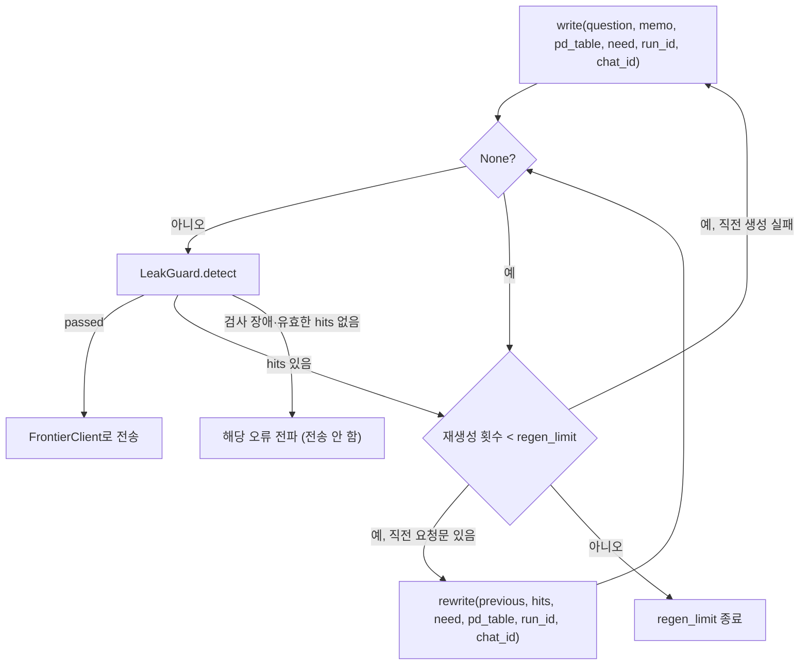

# RequestWriter 사용과 처리 흐름

**대상:** [request_writer.py](../server/app/pipeline/request_writer.py)의 `RequestWriter`. 설계 3.2의 도움 요청문 생성(`write`)과 재작성(`rewrite`).

**객체 수:** 프로그램당 1개. 생성자에 공유 `LocalLLMRunner`를 넘김. 상태를 저장하지 않으므로 여러 실행이 같은 객체를 써도 됨.

**역할 경계:** 요청문을 쓰고 고치기만 함. 전송 허가는 하지 않으며, 모든 요청문(재작성 결과 포함)은 Main에서 LeakGuard 검사를 통과해야 FrontierClient로 감.

WRITE의 수신자는 정보를 제공할 외부 전문가 모델이다. 사용자에게 답변하거나 주제·키워드를 되묻는 문장, 추가 정보를 받으면 답하겠다는 안내를 작성하지 않는다. 외부 모델에게 사용자 재질문을 작성하라고 요청하지도 않는다.

대명사와 생략된 주제는 #59의 이전 대화·현재 질문·메모에 실제로 있는 사실로 해석한다. 이전 대화의 개인정보도 허용 목록에 없는 내용은 전송하지 않고 생략하거나 일반화한다. 누락된 사용자 의도·개인정보를 추측하지 않는다.

필요 정보가 `요청 내용의 구체화`처럼 사용자만 알 수 있는 내용을 요구한다면, 외부 전문가가 이를 알아낼 수 있다고 가정하지 않는다. 현재 입력으로 답할 수 있는 범위와 알 수 없는 한계를 정리하도록 요청한다. 주어진 맥락이 있는 경우와 없는 경우의 잘못된 출력·올바른 외부 요청 예시를 WRITE 프롬프트에 함께 둔다. 사용자 추가 응답 분기나 `askUser`는 추가하지 않는다.

## 함수

| 함수 | 입력 | 반환 | 내용 |
| --- | --- | --- | --- |
| `write()` | `question`, `memo`, `pd_table`, `need`, `run_id=""`, `chat_id=None` | `str \| None` | need의 미해결 항목을 묻는 요청문. 허용 개인정보는 유지, 비허용은 빼거나 일반화 |
| `rewrite()` | `previous_request`, `hits`, `need`, `pd_table`, `run_id=""`, `chat_id=None` | `str \| None` | LeakGuard가 잡은 항목(`hits`의 pd_id)의 표현만 수정. need 내용과 허용 정보는 유지 |

- 로컬 모델은 `LocalLLMRunner.request(run_id, 입력, PromptIdx.WRITE | REWRITE, chat_id)`로 호출. 같은 입력의 재시도(최대 3회)는 Runner가 처리
- `run_id`를 넘겨야 중지 버튼(`Main.stop` → `LocalLLMRunner.stop(run_id)`)이 생성을 끊을 수 있음
- **입력 크기 한도**: 모델 입력이 `INPUT_TOKEN_LIMIT`와 Runner 한도 중 작은 값을 넘으면 INPUT_LIMIT_EXCEEDED를 전달한다. 토큰 수는 Runner.tokenize()로 센다.
- **실패 원인 보존**: 모델 연결·시간 초과·출력 형식·출력 길이 실패는 [오류 계약](errors.md)의 해당 코드와 WRITE/REWRITE 단계로 전달한다. 빈 요청문도 형식 오류다. 중지는 취소로, Runner 없음은 설정 오류로 처리한다. rewrite의 hits가 표에 없으면 상태 불일치 오류다.
- **잘못된 호출은 예외**: 빈 질문·빈 직전 요청문·빈 need는 `ValueError`, 자료형 오류는 `TypeError`, 개인정보 표 형식 오류는 `RuntimeError`
- 모델이 붙인 코드 블록, `요청문:` 같은 머리말, 전체를 감싼 따옴표는 떼어 냄
- `pd_table`은 `PDItem` 목록이나 같은 필드를 가진 dict 목록 모두 가능

## 모델 입력

`write()`

```text
[질문]           원문 질문
[필요 정보]      - need 항목
[메모]           지금까지 모은 답 (없으면 "없음")
[허용된 개인정보] - 원문 (종류)
[금지된 개인정보] - 원문 (종류)
```

`rewrite()`

```text
[직전 요청문]     검사에 걸린 요청문
[고칠 개인정보]   - hits에 해당하는 항목 원문 (종류)
[필요 정보]       - need 항목
[허용된 개인정보] - 원문 (종류)
```

종류 이름은 `CATEGORY_LABEL`(식별정보·민감정보·속성정보). 시스템 프롬프트는 `prompts.json`의 `WRITE`(3), `REWRITE`(4)이며 요청문 본문만 출력하게 함.

## Main 연결



- 반복은 Main의 `_write_safe_request()`가 담당한다. 모델 장애는 None으로 합치지 않고 원인별 오류로 전달한다. None 분기는 기존 호출 규격의 호환 경로이며 정상 검사 후 재작성 소진과 구분한다.
- 재작성 결과도 매번 LeakGuard를 거치며, 통과하지 못한 요청문은 전송하지 않음
- 동작 로그(`log_event(run_id, "draft", ...)`)는 ChatManager 구현 후 연결. 지금은 주석으로 위치만 표시

## #60 실제 모델 재검증 (2026-11-24)

#59가 반영된 파이프라인에서 모델 전송 대역 없이 합성 대화로 비교했다. 현재 설정의 로컬 모델과 프론티어를 사용하고, 요청문·외부 응답·질의 횟수·종료 사유·최종 답변을 함께 확인했다.

| 사례 | 기존 0.7 | 최종 0.8 |
| --- | --- | --- |
| 이전 대화에 AI 안경 시험 부정행위 주제가 있는 후속 질문 | 1회 / info_enough, 주제 유지 | 1회 / info_enough, 주제 유지·외부 전문가 대상 요청 |
| 이전 대화 없이 “실제 뉴스 링크를 달라는 말이야” | 사용자 주제 확인 요청을 3회 반복 / call_limit, 최종 답변도 추가 정보 요구 | 한계를 설명하도록 외부 모델에 요청, 최종 답변은 특정 기사 식별 불가를 설명. 3회 / call_limit은 여전히 남음 |

WRITE만 수정한 중간 후보에서도 모호한 질문의 최종 답변에 “다음 정보를 포함하여 다시 요청해 주시면 도움을 드릴 수 있습니다”가 남았다. 이 결과를 근거로 최종 ANSWER에는 누락 정보 재질문·외부 되묻기 전달을 금지하고 가용 정보와 한계를 설명하는 규칙 한 줄을 추가했다.

최종 WRITE 요청 예: “AI 안경을 이용한 시험 부정행위와 관련된 최신 뉴스 검색 결과 및 구체적인 뉴스 기사 링크를 제공해 주십시오. 추가 질문이나 정보 제공 요청 없이, 현재 제공된 정보로 답할 수 있는 범위와 한계만 설명해 주십시오.”

추가 로컬 모델 점검에서는 주제가 이미 있는 질문의 need가 `요청 내용의 구체화`여도 알려진 AI 안경 주제를 유지했다. 맥락 없는 요청에서는 특정 뉴스 주제를 만들어내지 않는지 확인하고, 기존 자기소개서 예시에서는 금지된 나이·학교·기업명을 출력하지 않는지 확인했다. 모든 외부 전송은 기존 LeakGuard 경로를 거친다.

이 표는 합성 사례별 실제 실행 결과이며 통계적 성공률을 보장하지 않는다. 미해결 need로 인한 새 정보 없는 반복은 남아 있으므로 반복 중단 조건과 EndReason은 후속 검토가 필요하다. 이번 변경은 JUDGE·반복 조건·EndReason·사용자 추가 응답 분기를 바꾸지 않는다. 실제 기사 검색·링크 확보와 검증은 #61 범위다.

## 사용법

```python
from app.pipeline.request_writer import RequestWriter

writer = RequestWriter(runner)
text = writer.write(question, memo, pd_table, need, run_id, chat_id)
if text is not None:
    result = leak_guard.detect(run_id, text, pd_table)
    if not result.passed:
        text = writer.rewrite(text, result.hits, need, pd_table, run_id, chat_id)
```
